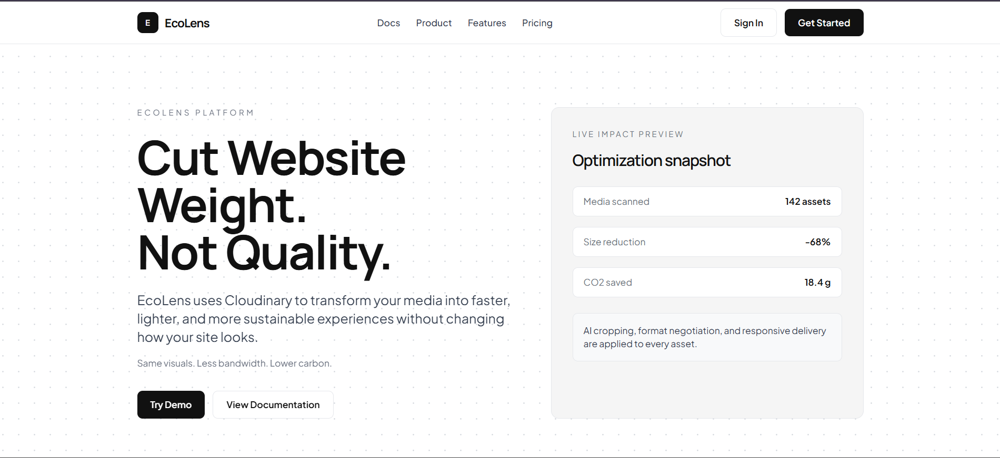
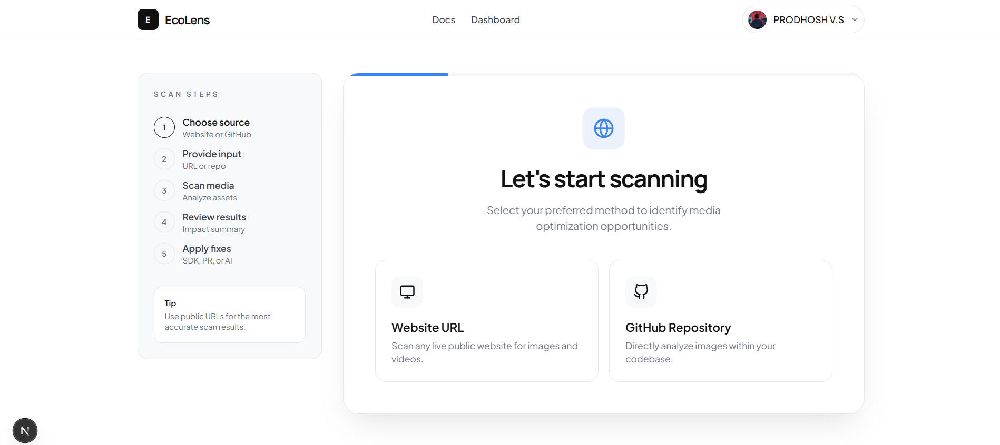
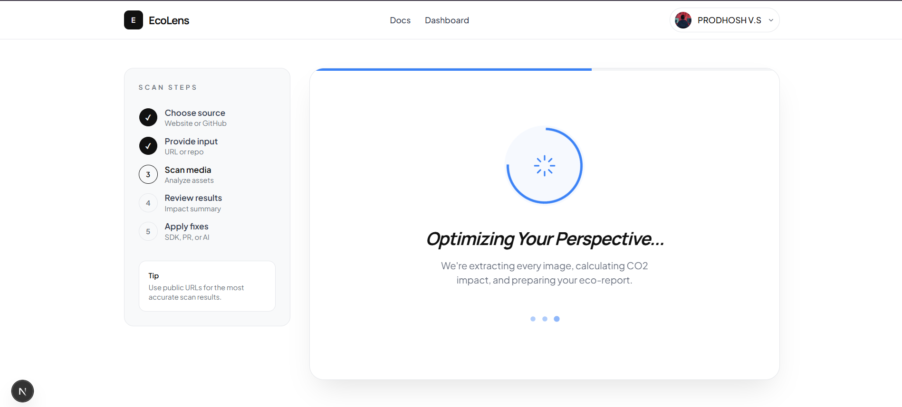
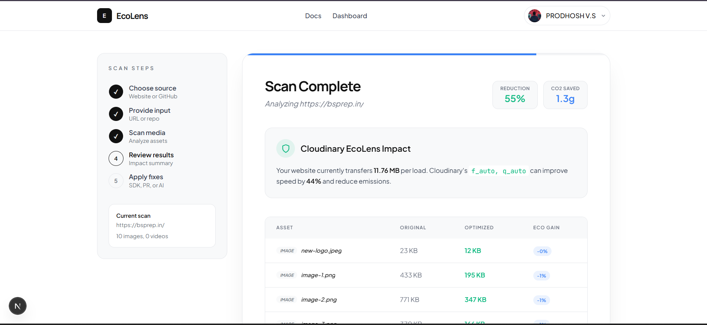
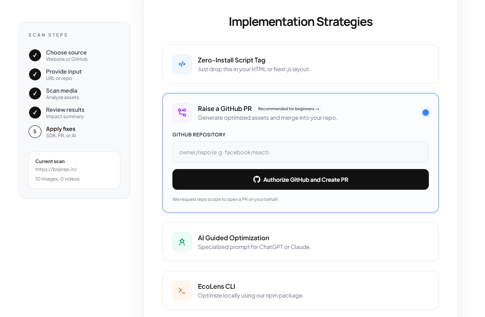

<div align="center">
<h1>EcoLens</h1>
</div>

### Real-time Website Media Optimization and Carbon Reduction

EcoLens is a platform designed to fix a common issue in modern web development: beautiful websites that are weighed down by unoptimized media. We help you identify, optimize, and deliver images and videos via Cloudinary to improve performance and reduce your digital carbon footprint.

---






## The Problem

We've all seen them: stunning, "vibe-coded" websites that look incredible but take ages to load. In the rush to build fast with modern frameworks like Next.js, proper image optimization is often the first thing that gets ignored. 

It's easier to just ship a 5MB high-res asset than it is to build a complex processing pipeline. But the cost is real. Your users deal with sluggish load times, and every unnecessary megabyte transferred contributes to global carbon emissions.

EcoLens was built to bridge this gap. We make optimization effortless so you can keep the "vibe" without the bloat.

---

## Key Features

- **Smart Scanning**: Extract every image and video from any public URL or GitHub repository.
- **Performance Analytics**: See a clear comparison between your original assets and their optimized versions.
- **Carbon Tracking**: Calculate the exact CO2 savings achieved through better media delivery.
- **Flexible Integration**:
  - **JS SDK**: Drop a single script tag into your project to optimize everything at runtime.
  - **GitHub PRs**: Let EcoLens open a pull request to refactor your code automatically.
  - **AI Prompting**: Use specialized prompts for tools like Claude Code or Cursor to clean up your repo.
  - **EcoLens CLI**: Run optimizations locally from your terminal.

---

## EcoLens CLI

The EcoLens CLI is a lightweight tool for local image optimization using Cloudinary fetch transformations.

### Installation
```bash
npm install -g ecolens
```

### Quick Start
```bash
# Set up your config
npx ecolens install

# Run the optimization
npx ecolens optimize
```

**Repository**: [PRODHOSH/ecolens-cli](https://github.com/PRODHOSH/ecolens-cli)  
**NPM Package**: [ecolens](https://www.npmjs.com/package/ecolens)

---

## Tech Stack

- **Framework**: Next.js 14 (App Router) with TypeScript
- **Styling**: Vanilla CSS
- **Authentication**: Supabase (Google, GitHub, Email)
- **Media Optimization**: Cloudinary AI
- **Reporting**: pdf-lib for eco-reports

---

## Getting Started

1. **Clone and Install**:
   ```bash
   git clone https://github.com/PRODHOSH/ecolens-cloudinary.git
   cd ecolens-cloudinary
   npm install
   ```

2. **Configuration**:
   Copy .env.example to .env.local and add your credentials:
    - NEXT_PUBLIC_SUPABASE_URL
    - NEXT_PUBLIC_SUPABASE_ANON_KEY
    - CLOUDINARY_CLOUD_NAME

3. **Development**:
   ```bash
   npm run dev
   ```

---

## License

Distributed under the MIT License.
